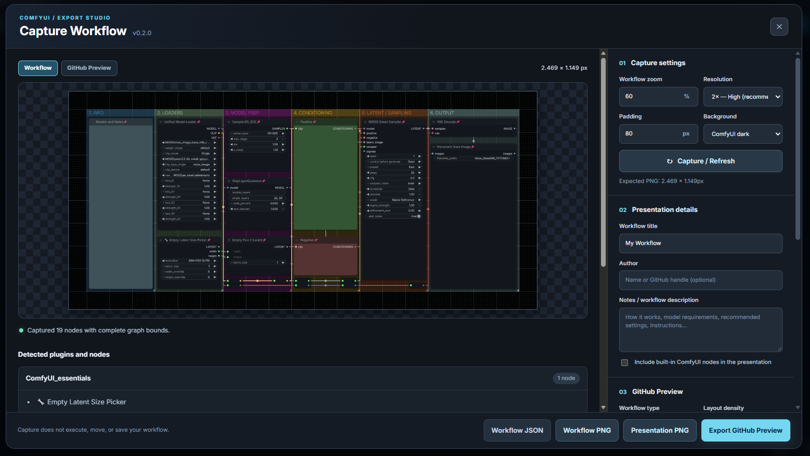

<div align="center">

# ComfyUI Workflow Capture
**Captures all the nodes in a ComfyUI Workflow.**


</div>

A frontend extension for capturing **all the nodes in a ComfyUI Workflow** and exporting original full-resolution screenshots, detailed presentations, or compact **GitHub README previews** with custom-node dependencies and example outputs.

**This is a prototype intended for real-world testing, not a verified production release.** Designed first for **ComfyUI's classic LiteGraph node canvas**. Nodes 2.0, graph subviews, and widgets rendered as separate HTML elements need further compatibility testing.

# Installation

## Git
Open a terminal inside the ComfyUI `custom_nodes` directory and clone the repository:

```bash
cd ComfyUI/custom_nodes
git clone https://github.com/VictorDmAlves/comfyui-workflow-capture
```

## ZIP
1. Download the repository as a ZIP file.
2. Extract it into `ComfyUI/custom_nodes/`.
3. Make sure the final structure is not nested twice.

Open any Workflow and go to **Edit → Capture Workflow**. A canvas context-menu item is also included as a fallback.

# Features
- Automatically finds the union of **all Workflow nodes and groups**, including isolated nodes far outside the current viewport, including those at negative coordinates.
- Renders a disconnected full-size canvas (not a screenshot of the visible browser window); does not change the Workflow's node coordinates, zoom, execution parameters, or saved graph data.
- **Default zoom: 60%, resolution: 2× High (recommended)**. Select resolution 1×, 2×, or 3× (pixel density multiplier), padding, and background color.
- Previews the entire capture and displays its actual **pixel dimensions**.
- Lists all installed node packages and the specific node classes (with usage counts). Built-in nodes can be included in the presentation.
- Optional author/title/notes and up to six example images with individual captions.
- Export **Workflow PNG**, **Presentation PNG**, **GitHub Preview PNG**, and Workflow **JSON** independently.

## Export modes
| Workflow PNG | Presentation PNG | GitHub Preview PNG |
| --- | --- | --- |
| Original full-resolution Workflow | Detailed documentation poster | Horizontal, compact README cover |
| No additional text or photos | Author, notes, every detected plugin/node, all six examples | Title, author, type/model tags, concise summary, top custom plugins and up to 3 examples |
| Use for technical inspection and archive | Use for detailed sharing and documentation | Use as a quick visual overview before users download the Workflow |

The original **Workflow PNG** has the same pixel dimensions as the capture, regardless of which preview or export mode is selected. The GitHub preview uses a scaled thumbnail of that capture; opening the separate Workflow PNG is still recommended to read every widget/parameter.

## GitHub Preview
Choose **Workflow type**, optionally provide a **Model / backend** and a **Short README summary**, then select a density:
- **Compact (default):** 2000 × 880 px; optimal for a concise README intro.
- **Balanced:** 2000 × 1060 px; gives the graph and examples more vertical room.
- **Detailed:** 2000 × 1220 px; more space for the photos and a longer description.

The first three uploaded examples form a portrait-friendly mosaic: first featured, two smaller. With fewer examples the layout adapts; with no examples, it shows notable custom node names instead. Known custom-node packages are prioritized and frontend reroutes/unknown groups are omitted from the GitHub cover (they remain in Presentation PNG). The **GitHub Preview** tab lets you inspect this layout before exporting; edits to the relevant fields update that preview without recapturing the graph.

# Notes and known limitations
1. **Browser canvas limits:** the plugin deliberately rejects outputs wider/taller than 16,384px or greater than 48 megapixels, rather than silently cropping nodes. Set a smaller zoom or multiplier for unusually large graphs. Browsers/GPU memory may impose stricter limits.
2. **HTML-based widgets:** nodes containing DOM overlays, newer Nodes 2.0 rendering, embedded HTML editors, and some live image previews may not appear completely. Classic LiteGraph canvas nodes are the first target.
3. **Full graph capture:** this currently captures the active graph view (`app.graph`), not the interior of every nested subgraph. Open a subgraph before capturing it separately.
4. **Package detection:** package names come from Python class source locations via the read-only `/vic_workflow_capture/node_map` route, with `/object_info` as fallback. Some unconventional plugins may show `Unknown / frontend` or a module name. No network calls are sent to external services.
5. **One-shot output:** title, captions, and example images are kept within the modal only; they are not stored inside the user's Workflow. Export before closing the window.
6. **Capture freshness:** to change zoom/padding/resolution, click **Capture / Refresh**; changes are not recaptured automatically, to avoid expensive renders.
7. **Image metadata:** when checked, Workflow JSON is included **within** the PNG file. Images shared this way may reveal full Workflow details.
8. **Screenshot implementation:** the extension temporarily swaps only the rendering canvas/context references on the existing LiteGraph canvas and restores them immediately with `try/finally`. It does not alter graph coordinates or graph serialization; unusual third-party canvas patches may need compatibility adjustments.

# Sources
- **[ComfyUI — main repository](https://github.com/Comfy-Org/ComfyUI)** — Backend, custom-node integration, and server infrastructure.
- **[ComfyUI Frontend — official repository](https://github.com/Comfy-Org/ComfyUI_frontend)** — Frontend extension architecture and application canvas integration.
- **[ComfyUI Frontend — Extension APIs](https://github.com/Comfy-Org/ComfyUI_frontend#developer-apis)** — `app.registerExtension`, custom commands, and `menuCommands` used for the **Edit → Capture Workflow** entry.
- **[ComfyUI Frontend — LiteGraph source](https://github.com/Comfy-Org/ComfyUI_frontend/tree/main/src/lib/litegraph)** — Graph and canvas rendering behavior, node and group geometry, viewport culling, and `DragAndScale`. LiteGraph has been integrated directly into the frontend repository since August 2025.
- **[ComfyUI Frontend — LiteGraph API](https://github.com/Comfy-Org/ComfyUI_frontend/blob/main/src/lib/litegraph/API.md)** — Modern LiteGraph compatibility and API notes.
- **[PNG Specification (W3C)](https://www.w3.org/TR/png-3/)** — PNG structure and the optional UTF-8 `iTXt` metadata chunk used to embed a workflow JSON.
- **[MDN — Canvas API](https://developer.mozilla.org/en-US/docs/Web/API/Canvas_API)** — Browser canvas drawing, offscreen composition, and image export.

# License
See [LICENSE](LICENSE).